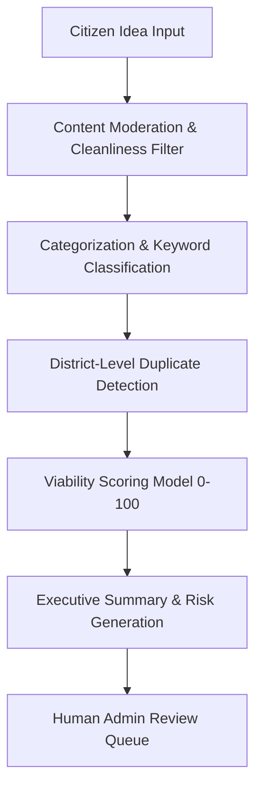

# AI Architecture & Screening Engine
**Platform:** EKOTAI BOL (একতাই বল)  

---

## 1. AI Assistant Philosophy
AI is utilized strictly as an objective triage assistant to help human reviewers identify duplicates, assess initial viability, and structure problem statements. **AI is never the final decision-maker** regarding idea publication or project funding.

---

## 2. AI Processing Pipeline

---

## 3. Heuristic Scoring Factors
- **Local Feasibility (30%):** Does the solution use locally available resources and labor?
- **Community Impact (30%):** How many families or farmers benefit?
- **Cost Realism (20%):** Is the proposed budget realistic for the scale of the problem?
- **Risk & Sustainability (20%):** Can the project sustain itself after initial funding?
