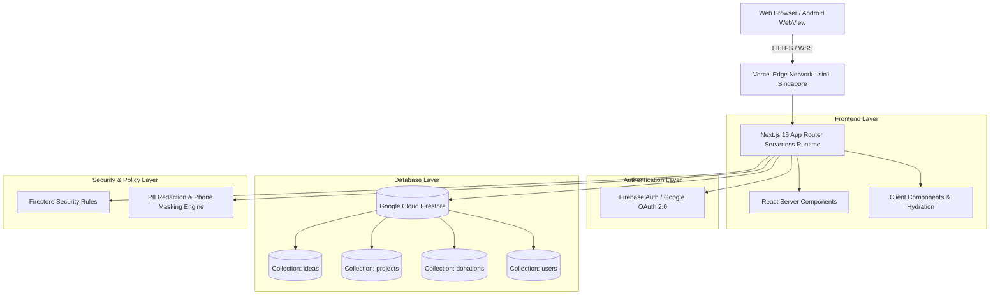

# System Architecture Specification
**Platform:** EKOTAI BOL / Codename: JANOSHOKTI  
**Standard:** 12-Tier Enterprise Architecture  

---

## 1. High-Level Architecture Diagram

---

## 2. Layer Definitions

1. **Presentation Layer:** Next.js App Router with Tailwind CSS, Lucide Icons, and dark/light mode themes.
2. **Authentication Layer:** Firebase Authentication with Google OAuth popup and ID token session state.
3. **API & Route Layer:** Next.js Server Components and client hooks interacting directly with Firebase SDK.
4. **Data Layer:** Cloud Firestore with strict document schema enforcement.
5. **Security Layer:** PII masking (author phone hidden, donor phone masked to `0171****890`).
6. **Edge Infrastructure:** Vercel Singapore region (`sin1`) for optimal Bangladesh latency (~35ms).
