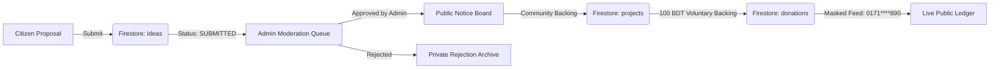

# Existing Features Inventory
**Platform:** EKOTAI BOL (`ekoitaibol.com`) / Codename: JANOSHOKTI  
**Status:** Live on Production Edge & Connected to Cloud Firestore

---

## 1. Feature Map & Current Operational Status

| Route / Module | Purpose | Live State | Cloud Firestore Integration |
| :--- | :--- | :--- | :--- |
| **`/` (Homepage)** | Public showcase, 4-step civic model, real metrics, featured approved ideas | ✅ Active | Dynamic query on `projects` and `ideas` collections |
| **`/submit-idea`** | Multi-field citizen proposal form with AI screening copilot | ✅ Active | Writes to `ideas` collection with status `SUBMITTED`, `isPublic: false` |
| **`/notice-board`** | Ranked public civic notice board, 5-star ratings, constructive critique | ✅ Active | Queries `ideas` where `status == 'PUBLISHED'` and `isPublic == true` |
| **`/projects`** | Active community initiatives, 100 BDT voluntary micro-funding, masked ledger | ✅ Active | Queries `projects`, writes to `donations` with `0171****890` phone masking |
| **`/welfare`** | Institutional blueprint for Labor Act 2006 & Pragati Universal Pension Scheme | ✅ Active | Educational & governance documentation |
| **`/about`** | Transparency guidelines, mission, anti-fraud governance policies | ✅ Active | Static governance charter |
| **`/admin`** | Super Admin moderation portal, idea approval/rejection queue, project creation | ✅ Active | Updates idea status (`PUBLISHED` / `REJECTED`), creates new projects |

---

## 2. Authentication Capabilities
- **Google OAuth Popup:** Uses `signInWithPopup(auth, googleProvider)`.
- **Domain Diagnostics:** Alerts and guides administrators to whitelist domains when `auth/unauthorized-domain` triggers.
- **Instant Test Bypass:** Allows 1-click elevation as:
  - `CITIZEN` (`citizen-tester-01`)
  - `SUPER_ADMIN` (`admin-super-01` with elevated moderation permissions)
- **Role Verification:** Evaluates user email against `DEFAULT_ADMIN_EMAILS` and Firestore `users/{uid}.role`.

---

## 3. Data Flow Architecture

