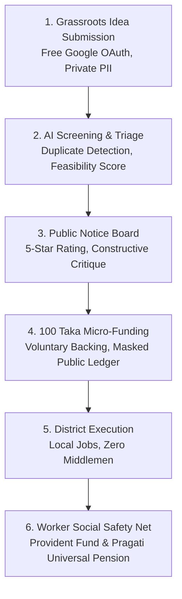

# Product Requirements Document (PRD)
**Product Codename:** JANOSHOKTI / EKOTAI BOL (`ekoitaibol.com`)  
**Version:** 1.0 (Production Release)  
**Target Market:** Bangladesh (Rangpur Pilot Division, expanding nationwide across 64 Districts)  
**Primary Language:** Bengali (বাংলা) with English system terminology  

---

## 1. Executive Summary
EKOTAI BOL (একতাই বল) is a civic innovation and decentralized social development platform designed to bridge the gap between grassroots problem-solvers and community resources. It enables citizens across 64 districts in Bangladesh to submit local challenges and solutions anonymously, subjects them to AI-assisted viability screening, allows public discussion and rating on an open notice board, aggregates voluntary 100 Taka micro-donations with full ledger transparency, and facilitates localized project execution that guarantees fair employment and universal pension security under Bangladesh Labor Act 2006.

---

## 2. Core Pillars & Business Model

---

## 3. User Roles & Access Hierarchy

1. **Anonymous Visitor:** Browses landing page, reads public notice board, views ongoing projects, and inspects public ledger.
2. **Authenticated Citizen:** Logs in via Google OAuth; submits ideas freely; posts ratings and reviews on public ideas; contributes voluntary donations.
3. **Idea Submitter:** Retains a private tracking ID for submitted proposals; receives review status updates; identity kept anonymous from public notice board.
4. **Community Backer / Donor:** Contributes 100 BDT or custom voluntary amounts; receives verifiable receipt; phone number masked in public ledger (`0171****890`).
5. **District Project Manager:** Coordinates ground implementation in regional upazilas; updates milestone logs and expense vouchers.
6. **Super Administrator / Governance Board:** Reviews submitted ideas in moderation queue; approves or rejects proposals; initiates new fundraising campaigns; maintains anti-fraud vigilance.

---

## 4. Key Functional Modules

### 4.1 Idea Submission Engine (`/submit-idea`)
- **Eligibility:** Free for all authenticated users (Google OAuth).
- **Mandatory Fields:** Title, Problem Statement, Proposed Solution, Division, District, Upazila, Category, Submitter Phone Number (held strictly confidential).
- **AI Copilot Assist:** Real-time client-side / edge simulation computing viability score (0-100), duplicate check, category suggestions, and risk flags.
- **Privacy Enforcement:** Full name and phone are stored in private database fields and never serialized to public feeds.

### 4.2 Public Notice Board & Ranking (`/notice-board`)
- **Query Constraints:** Displays exclusively approved ideas (`status == 'PUBLISHED' && isPublic == true`).
- **Rating System:** 5-star community voting with weighted score calculation.
- **Review Taxonomy:** Three structured feedback streams: Positive Feedback (পজেটিভ), Constructive Critique (নেগেটিভ), and Improvement Proposals (উন্নয়নের প্রস্তাব).

### 4.3 Transparent Project Ledger & Micro-Donations (`/projects`)
- **Standard Contribution:** 100 Taka voluntary micro-backing model.
- **Ledger Security:** Every donation records timestamp, project reference, masked phone, payment gateway reference, and status.
- **Real-Time Progress:** Dynamic progress bars reflecting collected funds against verified project targets.

### 4.4 Super Admin Moderation & Governance Portal (`/admin`)
- **Role Guard:** Restricted to users with `role: 'SUPER_ADMIN'` or emails in `DEFAULT_ADMIN_EMAILS`.
- **Idea Moderation:** One-click "Approve" (promotes to public notice board) or "Reject" (archives with reason).
- **Project Initiation:** Form to create verifiable projects with defined fundraising goals and district designations.
- **Audit Verification:** Visual inspection of live Firestore records and platform counters.

---

## 5. Non-Functional Requirements
- **Performance:** Prerendered static routes; sub-50ms TTFB via Singapore (`sin1`) edge CDN.
- **Security:** Zero SQL/NoSQL injection vulnerabilities; sanitized DOM rendering; TLS 1.3 encryption.
- **Accessibility:** High contrast ratios (WCAG AA compliance); Bengali-optimized typography.
- **Reliability:** 99.9% uptime backed by serverless Next.js edge and Google Cloud Firestore.
